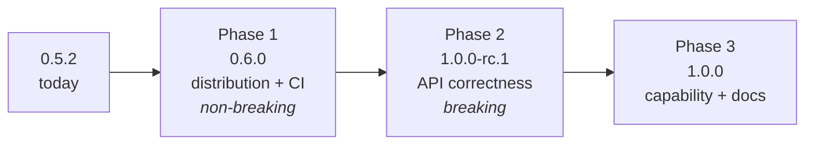
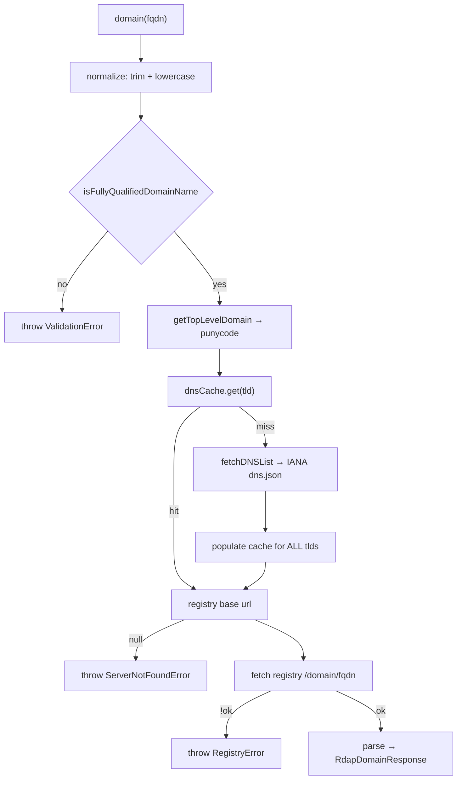
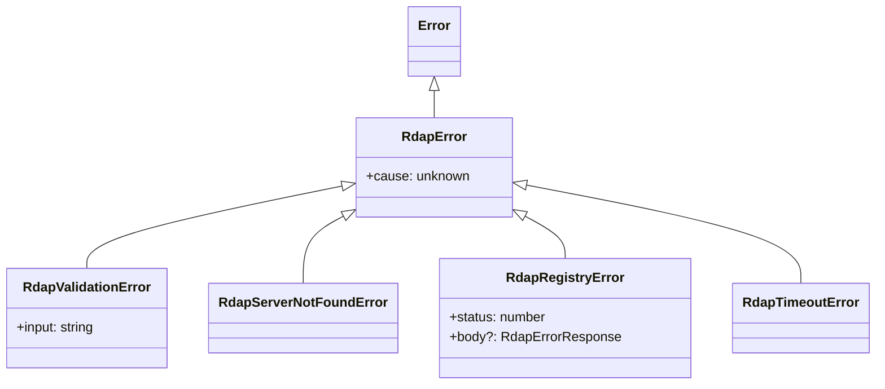

# ✨ node-rdap 1.0.0 stable release

## Overview

`node-rdap` is at 0.5.2 with a healthy internal foundation — 100% test coverage, a fully
offline deterministic suite, TypeScript 7, and clean packaging of build output. What it does
**not** yet have is a public surface worth freezing. A 1.0.0 is a promise that the API is
stable; three classes of problem make that promise unsafe to make today:

1. **A feature nobody can reach.** The package builds, tests and ships a complete CLI that
   cannot be invoked after install, because there is no `bin` field.
2. **Types that misdescribe reality.** Response types are intersections of success and error
   shapes, and several fields marked required are absent from real registry responses.
3. **Inconsistent error and validation behaviour** across the three public functions.

Items 2 and 3 are breaking to correct, so they must land *before* 1.0.0, not after.

This plan sequences the work into three phases: non-breaking distribution fixes (ship as
0.6.0), breaking API corrections (1.0.0-rc.1), then capability and documentation (1.0.0).

## Decisions Taken

Settled 2026-08-27, before implementation started.

| # | Decision | Outcome | Affects |
|---|---|---|---|
| 1 | Supported Node floor | **`^22.12.0 \|\| >=24`** — LTS and current only | Phase 1 |
| 2 | 1.0 endpoint scope | **domain, ip, autnum, nameserver and entity** | Phase 3 |
| 3 | CLI in the published package | **Kept**, with the `bin` and guard fix | Phase 1–2 |
| 4 | `punynode` dependency | **Release punynode 1.0**, depend on `^1` | Phase 1 (prerequisite) |

### On decision 1 — declaring a floor does not lock anyone out

The concern behind this decision was whether raising the floor would stop users on older
runtimes from installing. It does not. `engines` is **advisory by default**; the publisher
cannot force a hard failure. Verified:

```
$ npm config get engine-strict
false

$ npm install <dep requiring node >=99>
npm warn EBADENGINE  required: { node: '>=99.0.0' }
npm warn EBADENGINE  current:  { node: 'v24.14.0' }
added 1 package                                   # exit 0 — installed
```

Only a consumer who has *opted in* with `engine-strict=true` in their own `.npmrc` gets a
hard error, and that is their setting to relax:

```
$ npm install <same dep>          # with engine-strict=true
npm error engine Unsupported engine
```

So `^22.12.0 || >=24` documents the versions that are tested and supported, while users on
Node 20 still install successfully and merely see a warning. That is the intended purpose of
the field: a statement of support, not an access control.

*(Caveat: the equivalent pnpm behaviour was only exercised against a local path dependency,
which pnpm links rather than resolves, so pnpm's registry-install behaviour here is
untested. The npm result above is the one that governs the majority of consumers.)*

## Problem Statement

### The CLI is unreachable, and adding `bin` alone will not fix it

`package.json` has no `bin` entry, so `npm i -g node-rdap` installs nothing runnable and
`npx node-rdap` does nothing. The only way to invoke the CLI today is by path:
`node ./node_modules/node-rdap/dist/tsc/cli.js`.

Adding `bin` is necessary but **not sufficient**. `src/cli.ts` guards its entry point with:

```ts
// src/cli.ts
if (process.argv[1] && import.meta.url === pathToFileURL(process.argv[1]).href) {
	main();
}
```

npm installs bins as **symlinks**. `import.meta.url` resolves to the real path while
`process.argv[1]` is the symlink, so the comparison fails and `main()` never runs.

**This was verified, not assumed.** Running the built CLI through a symlink produces no
output and exits 0:

```
$ ln -s $(pwd)/dist/tsc/cli.js /tmp/bintest/node-rdap
$ node /tmp/bintest/node-rdap --version
                                    # <- nothing, exit 0
$ node dist/tsc/cli.js --version
0.5.2
```

Shipping `bin` without fixing the guard would publish a CLI that silently does nothing —
strictly worse than today, because it would *look* installed.

### The response types are wrong in both directions

```ts
// src/types.ts:217-219
export type RdapDomainResponse = RdapErrorResponse & RdapDomainSuccessResponse;
export type RdapIpResponse     = RdapErrorResponse & RdapIpSuccessResponse;
export type RdapAutnumResponse = RdapErrorResponse & RdapAutnumSuccessResponse;
```

An **intersection** asserts every response simultaneously carries a required
`errorCode: number` *and* `rdapConformance: string[]`. No real response matches. Consumers
are told `errorCode` always exists (it never does on success) and cannot narrow.

Separately, fields declared required are frequently absent. Verified against live
responses:

| Type | Declared required | Present in real response? |
|---|---|---|
| `RdapDomainObjectClass.variants` | yes | **no** (google.com) |
| `RdapDomainObjectClass.remarks` | yes | **no** (google.com) |
| `RdapIPNetworkObjectClass.remarks` | yes | **no** (8.8.8.8) |
| `RdapAutonomousSystemNumberObjectClass.remarks` | yes | **no** (AS15169) |

So `result.remarks.map(...)` typechecks and throws `TypeError` at runtime. The type system
is actively producing bugs rather than preventing them.

### Error handling is inconsistent and lossy

- `src/client.ts:19-55` — `domain()` wraps its whole body in one `try/catch` and rethrows
  `Failed to fetch RDAP domain data: <message>`. "No server for TLD", "registry returned
  404" and "network unreachable" all collapse into one opaque string. It also re-wraps its
  own thrown errors, producing doubled messages.
- `src/client.ts:57-76` — `ip()` **never checks `response.ok`**. A registry 404 is parsed
  and returned as a success value, typed as a success.
- `src/client.ts:78-94` — `autnum()` has the same gap.
- `src/client.ts:58` — `//Todo: Validate IP String.` Validation happens by accident, when
  `ip-matching`'s `matches()` throws mid-scan, leaking that dependency's wording
  (`"Value has to be in the range of 0-255"`) as this package's public error contract.

### CLI exits 0 on failure

`doCommand` (`src/cli/program.ts`) catches, prints via `console.error`, and returns. The
process exits 0, so `node-rdap ip not-an-ip` is undetectable in a script or CI pipeline.

### Packaging and project hygiene

| Gap | Detail |
|---|---|
| No `exports` field | Consumers can deep-import `node-rdap/dist/tsc/cache/asn.js`; internals can never be refactored |
| No LICENSE file | `package.json` says MIT; no file exists for scanners or GitHub to detect |
| No CI | Nothing runs `typecheck`/`lint`/`test`/`build` on push |
| `repository.url` | Uses deprecated `git://` protocol |
| `engines` is a no-op | `">=20.19.0 \|\| >=22.12.0"` — the second clause adds nothing, since anything ≥22.12 already satisfies ≥20.19. Node 21 and 23 are permitted |
| Dependency on a 0.x package | `@dcoffey-zengenti/punynode: ^0.1.0` — under semver, any 0.x bump may break. A 1.0.0 should not rest on a `^0.x` range |

## Proposed Solution

Correct the public surface **before** freezing it, in three sequenced phases where each
phase ends at a releasable version.



Phase 1 is entirely non-breaking and delivers the most user-visible win (a CLI that works).
Phase 2 carries every breaking change, so consumers absorb one migration, not several.
Phase 3 adds the capabilities a 1.0 is expected to have and documents the frozen surface.

## Technical Approach

### Architecture

The current request path, two levels deep — worth stating because a single `domain()` call
triggers a bootstrap fetch that populates the cache for *every* TLD:



Both hops make network requests. Any timeout, retry or error-typing change must be applied
to **both**, and it is easy to only remember the second.

### Proposed error hierarchy



Every error carries `cause` (Node's native `Error.cause`), so the underlying failure is
preserved rather than flattened into a string. `RdapRegistryError` carries the parsed RDAP
error body, which is where `errorCode`/`title`/`description` belong — not on the success
type.

### Implementation Phases

#### Phase 1: Distribution & infrastructure (non-breaking) → **0.6.0**

| # | Task | Files |
|---|---|---|
| 1 | Fix the entry guard to resolve symlinks before comparing | `src/cli.ts` |
| 2 | Add `bin` mapping | `package.json` |
| 3 | Add `exports` map, keep `main`/`types` as fallback | `package.json` |
| 4 | Add MIT LICENSE file matching the `license` field | `LICENSE` |
| 5 | `repository.url` → `git+https://`, add `bugs` + `homepage` | `package.json` |
| 6 | Set `engines` to `^22.12.0 \|\| >=24` (decision 1) | `package.json` |
| 7 | CI workflow: typecheck, lint, test+coverage, build, pack-smoke | `.github/workflows/ci.yml` |
| 8 | Release `punynode` 1.0, move dependency to `^1` (decision 4) | `package.json`, *punynode repo* |
| 9 | Readme: document the CLI, ESM-only, Node support | `Readme.md` |

The guard fix, verified working under both invocation styles:

```ts
// src/cli.ts
import { realpathSync } from "node:fs";
import { pathToFileURL } from "node:url";

const isEntryPoint = () => {
	const argv1 = process.argv[1];
	if (!argv1) return false;
	// npm installs bins as symlinks; import.meta.url is the resolved real path.
	return import.meta.url === pathToFileURL(realpathSync(argv1)).href;
};

if (isEntryPoint()) main();
```

```jsonc
// package.json
"bin": { "node-rdap": "./dist/tsc/cli.js" },
"exports": {
  ".": {
    "types": "./dist/tsc/client.d.ts",
    "import": "./dist/tsc/client.js"
  },
  "./package.json": "./package.json"
}
```

**Success criteria:** `npm pack`, install the tarball into a scratch directory, and
`node-rdap --version` prints the version. CI green on the supported Node matrix
(22 and 24). Node 20 users still install with a warning — see decision 1.

#### Phase 2: API correctness (breaking) → **1.0.0-rc.1**

| # | Task | Files |
|---|---|---|
| 1 | Correct optionality on every response interface | `src/types.ts` |
| 2 | Replace success/error intersections with success-only types | `src/types.ts` |
| 3 | Add the error hierarchy with `cause` chaining | `src/errors.ts` (new) |
| 4 | `domain()` throws typed errors; stop re-wrapping own errors | `src/client.ts` |
| 5 | `ip()` and `autnum()` check `response.ok` | `src/client.ts` |
| 6 | Explicit IP validation before cache lookup | `src/client.ts`, `src/utils/ip.ts` (new) |
| 7 | CLI sets `process.exitCode = 1` on failure | `src/cli/program.ts` |
| 8 | Audit and complete the exported type surface | `src/client.ts`, `src/types.ts` |
| 9 | Update tests that assert current error strings | `src/tests/*`, `src/cli/tests/*` |

Because errors now throw, success types should describe **only** success:

```ts
// src/types.ts — before
export type RdapDomainResponse = RdapErrorResponse & RdapDomainSuccessResponse;

// after
export type RdapDomainResponse = RdapDomainSuccessResponse;
// RdapErrorResponse stays exported, reachable via RdapRegistryError#body
```

CLI exit codes use `process.exitCode`, **not** `process.exit()`, so buffered stdout is not
truncated. Interactive mode must not set a failure code for a single bad line.

**Note on `RdapObjectClass`:** it is exported but its constituent interfaces
(`RdapEntityObjectClass`, `RdapNameserverObjectClass`, `RdapDomainObjectClass`) are not, so
consumers cannot name the members of the union they were given. Task 8 covers this.

**Success criteria:** a fixture TypeScript consumer project compiles against the public
types with no `as any` and correctly narrows optional fields.

#### Phase 3: Capability, scope & documentation → **1.0.0**

| # | Task | Files |
|---|---|---|
| 1 | `nameserver()` lookup — reuses the existing DNS bootstrap | `src/client.ts`, `src/types.ts` |
| 2 | `entity()` lookup — new object-tags bootstrap, cache and tag parsing | `src/client.ts`, `src/cache/entity.ts` (new), `src/utils/dns.ts` |
| 3 | Request timeouts via `AbortSignal.timeout`, applied to **all** hops | `src/utils/dns.ts`, `src/client.ts` |
| 4 | Public cache API: exported flush/reset, configurable TTL | `src/cache/index.ts`, `src/client.ts` |
| 5 | Document the 1.0 surface and its boundaries | `Readme.md` |
| 6 | Full API documentation | `Readme.md` |
| 7 | Migration guide 0.x → 1.0 | `Changelog.md` |
| 8 | Scheduled live-network CI job | `.github/workflows/live.yml` |

**Scope: `domain`, `ip`, `autnum`, `nameserver`, `entity` (decision 2).** The two additions
are very different in cost, and should not be estimated as one item.

**`nameserver` is small.** An RDAP nameserver query is `/nameserver/{name}`, served by the
same registry as the nameserver's own TLD. It reuses `dnsCache` and
`getTopLevelDomain` unchanged — effectively `domain()` with a different path segment.
`RdapNameserverObjectClass` already exists in `src/types.ts:117-132`.

**`entity` is a separate mechanism.** Entity lookups bootstrap from the RFC 8521
object-tags registry, **not** the bootstrap files this package already consumes. Verified
live:

```
GET https://data.iana.org/rdap/object-tags.json     → 200
description: "RDAP bootstrap file for service provider object tags"
services: 8 entries
sample:   [["info@arin.net"], ["ARIN"], ["https://rdap.arin.net/registry/", ...]]
```

Two consequences the implementation must account for:

1. **The tuple shape differs.** Every other bootstrap file is a 2-element
   `[[keys], [urls]]`. Object tags are a **3-element** `[[emails], [tags], [urls]]`. The
   existing `DNSList` type (`services: [string[], string[]][]`) and the shared `fetchList`
   helper in `src/utils/dns.ts` **do not fit it**. This needs its own type
   (`ObjectTagList`) and its own cache — it cannot reuse `dnsCache`'s shape.
2. **Coverage is inherently partial.** The registry has **8 entries**. Entity handles are
   resolved by the tag after the final `-` (e.g. `ABC123-ARIN` → `ARIN`). A handle with no
   registered tag cannot be resolved at all. `entity()` must therefore have a well-defined
   "no service provider for this handle" outcome, and the Readme must state plainly that
   entity lookups only work for tagged handles from those providers.

**Still out of 1.0 scope:** `help` and the search endpoints (`/domains?name=`, etc.). Say so
explicitly in the Readme so the boundary is documented rather than implied.

## Alternative Approaches Considered

| Approach | Why rejected |
|---|---|
| Return a `Result`/`Either` type instead of throwing | Breaking in a much larger way; `domain()` already throws, so throwing typed errors is the smaller migration and is idiomatic for a Node library |
| Return RDAP error bodies as values rather than throwing | Consumers overwhelmingly want `try/catch` for a failed lookup; the RDAP error body is still reachable via `RdapRegistryError#body` |
| Keep intersections, make every field optional | Loses the success/error distinction entirely and makes every field `T \| undefined`, which is worse to consume than the status quo |
| **Drop the CLI from the published package** instead of adding `bin` | Genuinely viable and cheaper — but the CLI is complete, tested and useful; the fix is small once the symlink issue is understood. Keep this as the fallback if CLI support is not wanted long-term |
| Generate types from an RDAP JSON Schema | No authoritative machine-readable schema covers registry variation; hand-maintained types with corrected optionality are the pragmatic path |
| Go straight to 1.0.0 in one release | Bundles a working CLI (wanted now) behind a breaking type migration (needs care). Phasing gets the CLI to users sooner |

## System-Wide Impact

### Interaction Graph

A single `domain()` call triggers: normalization → FQDN validation → punycode TLD
extraction → `dnsCache.get` → on miss, `fetchDNSList` → **one IANA request that populates
cache entries for every TLD in the list** → registry request. Two network hops, one of
which has whole-registry side effects on cache state.

`ip()` additionally selects its cache by a crude `addr.includes(":")` heuristic
(`src/client.ts:60`), so `"not.an.ip"` is routed to the **IPv4** cache and fails deep inside
`ip-matching`. Explicit validation (Phase 2, task 6) makes this deterministic and moves the
failure to the front.

### Error & Failure Propagation

| Layer | Today | After Phase 2 |
|---|---|---|
| `utils/dns.ts` fetch | Raw `TypeError: fetch failed` escapes | Wrapped as `RdapNetworkError`, `cause` preserved |
| Cache mask scan | `ip-matching` message leaks as public contract | Pre-validated; `RdapValidationError` |
| `client.domain` | Everything flattened to one string, own errors re-wrapped | Typed error, rethrown untouched if already `RdapError` |
| `client.ip` / `autnum` | `response.ok` never checked; error body returned as success | `RdapRegistryError` with status and parsed body |
| CLI `doCommand` | Prints `e.toString()`, exit 0 | Prints message, sets `process.exitCode = 1` |

The re-wrap guard matters: `domain()` currently catches the `"RDAP Server ... not found"`
error it threw itself and wraps it again. Phase 2 must `if (error instanceof RdapError) throw error;`.

### State Lifecycle Risks

1. **Partial cache population on mid-loop failure.** The cold path in `src/cache/ipv4.ts`
   and `ipv6.ts` writes each mask into `maskCache` *as it iterates*, then calls `matches()`,
   which throws on a malformed address. A failed lookup therefore leaves the mask cache
   **partially populated**. A later lookup may match one of those few cached masks and
   return a registry without ever seeing a more specific mask later in the list. Low
   likelihood, real consequence. Mitigation: build into a local map and commit it to the
   cache only after the loop completes.
2. **No in-flight request coalescing.** N concurrent cold-cache lookups each trigger their
   own IANA fetch (thundering herd). Not a correctness bug, but a 1.0 should either
   coalesce or document it.
3. **Module-level singleton caches.** `autnumCache`, `dnsCache`, `ipv4Cache`, `ipv6Cache`
   are process-wide singletons with no reset exposed to library consumers. Long-lived
   processes cannot force a refresh without importing internals — which Phase 1's `exports`
   map will *block*. Phase 3 task 2 must land, or `exports` removes a capability people
   may rely on.

### API Surface Parity

Three surfaces expose the same capability and must move together:

| Capability | Library | CLI | Notes |
|---|---|---|---|
| domain / ip / autnum lookup | ✅ | ✅ | Error and validation changes must reach both |
| nameserver / entity lookup | Phase 3 | Phase 3 | New commands needed for parity, not just library functions |
| Typed errors | Phase 2 | Phase 2 | CLI renders them; exit code derives from type |
| Cache flush / reset | Phase 3 | ❌ | Decide whether the CLI needs a `cache` command |
| Timeout config | Phase 3 | Phase 3 | CLI needs a `--timeout` flag for parity |

### Integration Test Scenarios

Cross-layer scenarios that the current mocked unit tests cannot catch:

1. **Packed-tarball bin smoke test.** `npm pack`, install the tarball into a scratch dir,
   run the installed `node-rdap --version` **through the bin symlink**. Catches the entry
   guard failure and a wrong `bin` path. *This test would fail today.*
2. **Consumer import resolution.** From a scratch ESM project,
   `import { domain } from "node-rdap"` and `import type { RdapDomainResponse }`. Validates
   `exports`/`types` as a consumer resolves them, not via relative paths.
3. **Deep import is sealed.** `import "node-rdap/dist/tsc/cache/asn.js"` must **fail** once
   `exports` lands. Proves the surface is actually closed.
4. **Consumer typecheck fixture.** A `.ts` file consuming the public types that must
   compile — including narrowing `remarks`/`variants` as optional. Catches the required/
   optional lies and any future regression.
5. **Cold-cache concurrency.** Fire 10 concurrent `domain()` calls against a mocked IANA
   endpoint; assert the documented number of bootstrap fetches (1 if coalescing lands).
6. **Timeout budget.** Point at a server that never responds; assert `RdapTimeoutError`
   fires within the configured budget rather than hanging.

## Acceptance Criteria

### Functional Requirements

- [ ] `npm i -g node-rdap && node-rdap domain example.com` works on a clean machine
- [ ] `node-rdap ip not-an-ip` prints a clear error and **exits non-zero**
- [ ] `node-rdap --version` matches `package.json` (guarded by the existing drift test)
- [ ] `ip()` and `autnum()` reject on a non-OK registry response
- [ ] Invalid IP input throws `RdapValidationError` with this package's own wording, before any cache or network work
- [ ] All errors are `instanceof RdapError` and expose the underlying failure via `cause`
- [ ] `RdapRegistryError` exposes `status` and the parsed RDAP error body
- [ ] Public response types describe success only; no field is required unless present in real responses
- [ ] Every type reachable from the public API is exported and nameable
- [ ] `nameserver()` resolves via the existing DNS bootstrap and returns a typed response
- [ ] `entity()` resolves tagged handles via the object-tags registry
- [ ] `entity()` has a defined, documented outcome for a handle with no registered tag
- [ ] Requests time out on **every** network hop (bootstrap and registry), with a configurable budget
- [ ] Cache flush/reset is reachable from the public API

### Non-Functional Requirements

- [ ] `exports` prevents deep imports of internals
- [ ] LICENSE file present and matching `package.json`
- [ ] `engines` accurately describes supported Node versions
- [ ] No production dependency on a `^0.x` range
- [ ] Published tarball contains no tests or fixtures (already true — keep it true)

### Quality Gates

- [ ] Coverage stays at 100% statements, branches, functions and lines
- [ ] Test suite still passes with all outbound network traffic blocked
- [ ] CI runs `typecheck`, `lint`, `test`, `build` and the pack-smoke test on every push
- [ ] CI matrix covers each supported Node major
- [ ] Readme documents install, CLI, library, errors, caching, timeouts and Node support
- [ ] Changelog carries a 0.x → 1.0 migration guide

## Success Metrics

| Metric | Target |
|---|---|
| CLI reachable after global install | Works (currently impossible) |
| Failed CLI lookups detectable by scripts | Non-zero exit (currently always 0) |
| Public types matching real responses | 100% of required fields verified present |
| Deep-import paths resolvable | 0 |
| Coverage | 100%, maintained |
| CI wall-clock | < 2 minutes (suite is ~270ms offline) |

## Dependencies & Prerequisites

- ~~Decision — Node support floor~~ **Resolved:** `^22.12.0 || >=24` (decision 1).
- ~~Decision — 1.0 endpoint scope~~ **Resolved:** domain, ip, autnum, nameserver, entity
  (decision 2).
- ~~Decision — CLI kept or dropped~~ **Resolved:** kept (decision 3).
- **`@dcoffey-zengenti/punynode` 1.0 is a hard prerequisite** (decision 4). This is work in
  **another repository** and is the only cross-repo dependency in the plan. `node-rdap`
  1.0.0 cannot ship while it depends on a `^0.x` range, so punynode 1.0 must be released
  before the final 1.0.0 tag. It does **not** block Phases 1–2 otherwise, so start it early
  and in parallel.
- **No blocking external dependencies.** `AbortSignal.timeout` and `Error.cause` are
  available on every supported Node version.

## Risk Analysis & Mitigation

| Risk | Likelihood | Impact | Mitigation |
|---|---|---|---|
| `bin` ships a silently broken CLI via the symlink guard | **Confirmed** — reproduced | High | `realpathSync` fix (verified) + packed-tarball smoke test in CI |
| Making required fields optional breaks consumers | Medium | Medium | The fields were never actually present; the break surfaces latent bugs. Document in the migration guide |
| `exports` breaks an unknown deep-importer | Low | Medium | Ship in 0.6.0 while still pre-1.0; call it out in the changelog |
| Raising the Node floor excludes users | **Low** | Low | Verified non-issue: `engines` is advisory, npm warns and installs. Only consumers who opted into `engine-strict` are blocked, by their own setting |
| `entity()` resolves only tagged handles from 8 providers | **High** (inherent) | Medium | Not fixable — it is how RFC 8521 works. Define an explicit "no service provider for handle" outcome and document the limitation prominently |
| Object-tags 3-tuple breaks the shared bootstrap helper | Medium | Medium | Give it its own `ObjectTagList` type and cache; do not force it through `DNSList`/`fetchList` |
| punynode 1.0 slips and blocks the release | Medium | High | Start it in parallel with Phase 1; it gates only the final tag, not the rc |
| Offline tests miss a real IANA/registry format change | Medium | Medium | Scheduled (not per-PR) live CI job hitting real servers |
| Timeouts break slow-but-working registries | Low | Medium | Generous default (10s), configurable, documented |
| Partial cache population after a mid-loop throw | Low | Medium | Build locally, commit to cache after the loop completes |
| `^0.1.0` dependency changes underneath a 1.0 | Medium | High | Pin exactly or depend on a 1.x release of punynode |

## Resource Requirements

Single maintainer. Phase 1 is a short session of mechanical, well-understood changes.
Phase 2 is the substantial one — the type rework and error hierarchy touch every test that
asserts an error string. Phase 3 is additive. No infrastructure beyond GitHub Actions.

## Future Considerations

- `help` and the search endpoints (`/domains?name=`, `/nameservers?ip=`) — deliberately out of 1.0 scope
- Broader entity resolution if IANA's object-tags registry grows beyond its current 8 providers
- In-flight request coalescing for cold-cache bursts
- Pluggable cache backend (Redis) for multi-process deployments
- Injectable `fetch` for consumers with proxy or instrumentation requirements
- Retry with backoff on 5xx registry responses
- Structured `--json` CLI output for piping into `jq`

## Documentation Plan

| Document | Change |
|---|---|
| `Readme.md` | Add CLI usage, error handling, caching, timeouts, Node support, ESM-only note, and the explicit 1.0 scope statement |
| `Changelog.md` | 0.6.0, 1.0.0-rc.1 and 1.0.0 entries, plus a 0.x → 1.0 migration guide |
| `LICENSE` | New — MIT, matching `package.json` |
| `.github/workflows/ci.yml` | New — documents the supported matrix by encoding it |

## Sources & References

### Internal References

- `src/cli.ts` — entry guard that fails under a symlinked bin
- `src/cli/program.ts` — `doCommand`, the exit-code gap
- `src/client.ts:19-55` — `domain()` lossy error wrapping
- `src/client.ts:57-76` — `ip()` missing `response.ok` check and the `//Todo: Validate IP String` marker
- `src/client.ts:78-94` — `autnum()` missing `response.ok` check
- `src/types.ts:217-220` — success/error intersections
- `src/types.ts:134-191` — object classes with over-required fields
- `src/cache/ipv4.ts:32-49` — incremental cache population on the cold path
- `package.json` — missing `bin`, `exports`; `git://` repository url; no-op `engines`
- `src/tests/helpers/network.ts` — existing fake-network harness to extend for new scenarios

### Verification Performed While Planning

- Symlinked-bin failure reproduced, and the `realpathSync` fix confirmed to work under both
  direct and symlinked invocation
- Required-but-absent type fields confirmed against live `google.com`, `8.8.8.8` and
  `AS15169` responses
- `engines` range semantics confirmed: the second clause is redundant

### External References

- RFC 7480–7484 (RDAP protocol and bootstrap registries)
- RFC 9082 / 9083 (RDAP query format and JSON responses)
- IANA RDAP bootstrap registries: `https://data.iana.org/rdap/`
- Node.js release schedule (Node 20 EOL, April 2026)
- Node docs: `Error.cause`, `AbortSignal.timeout`, package `exports`
